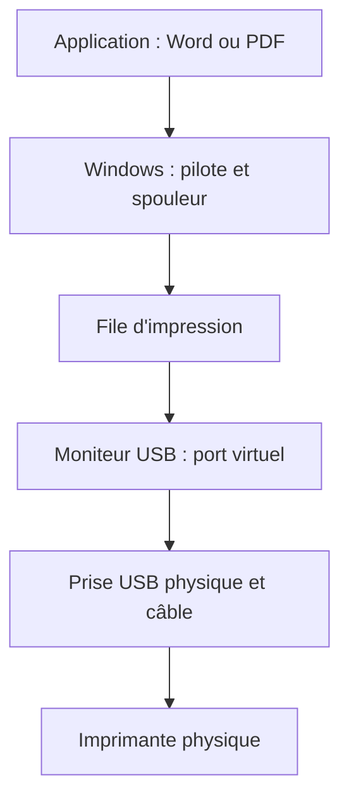
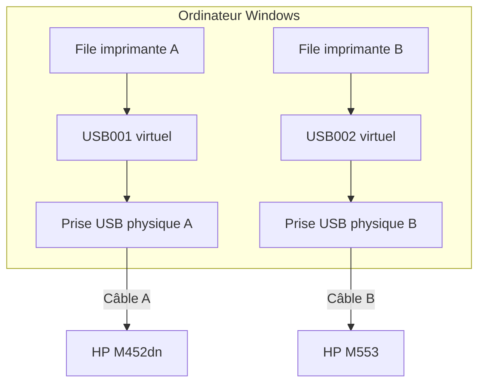
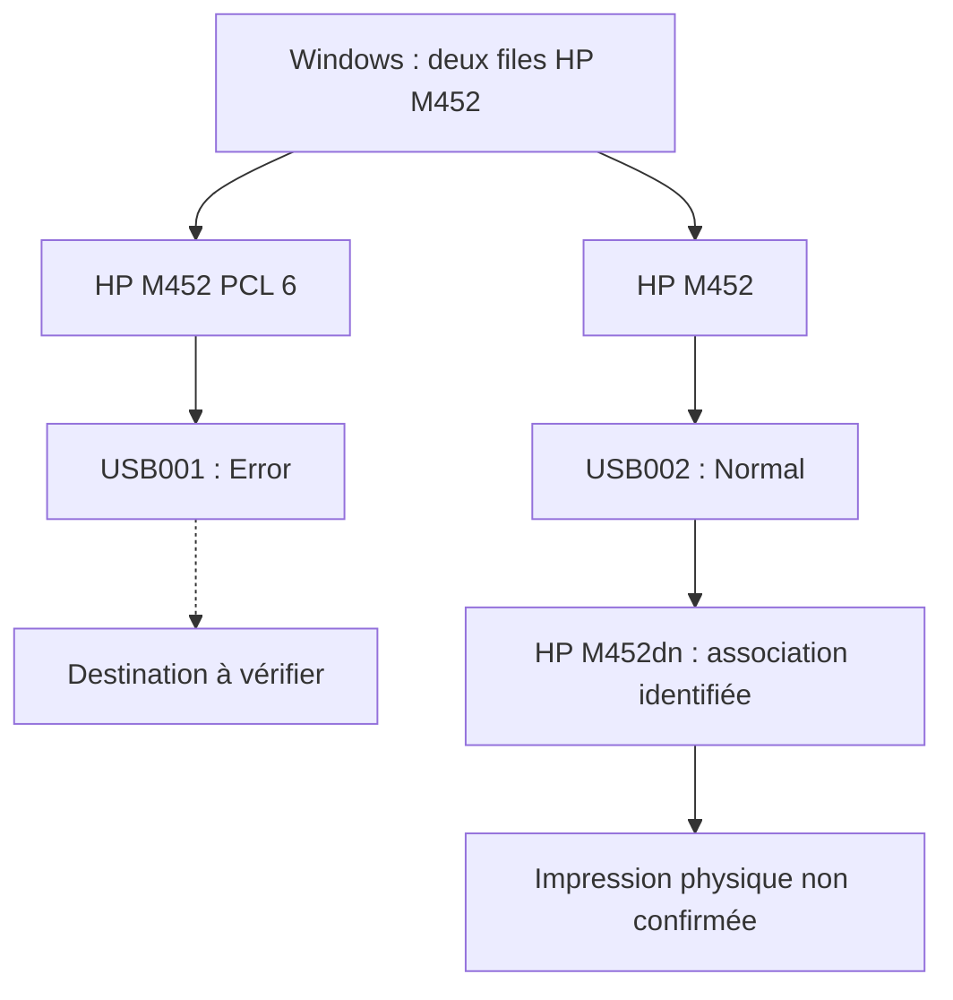
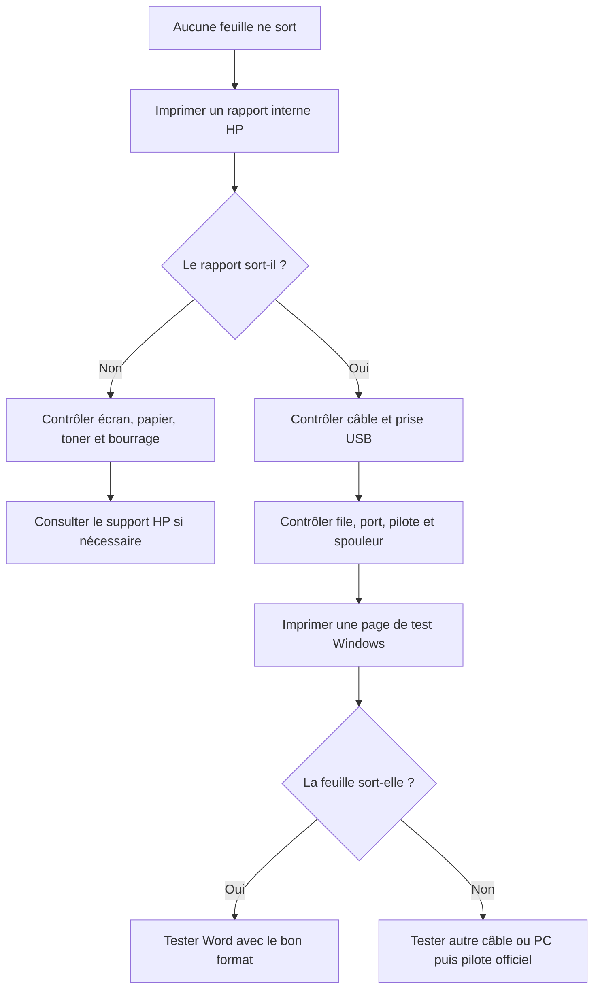
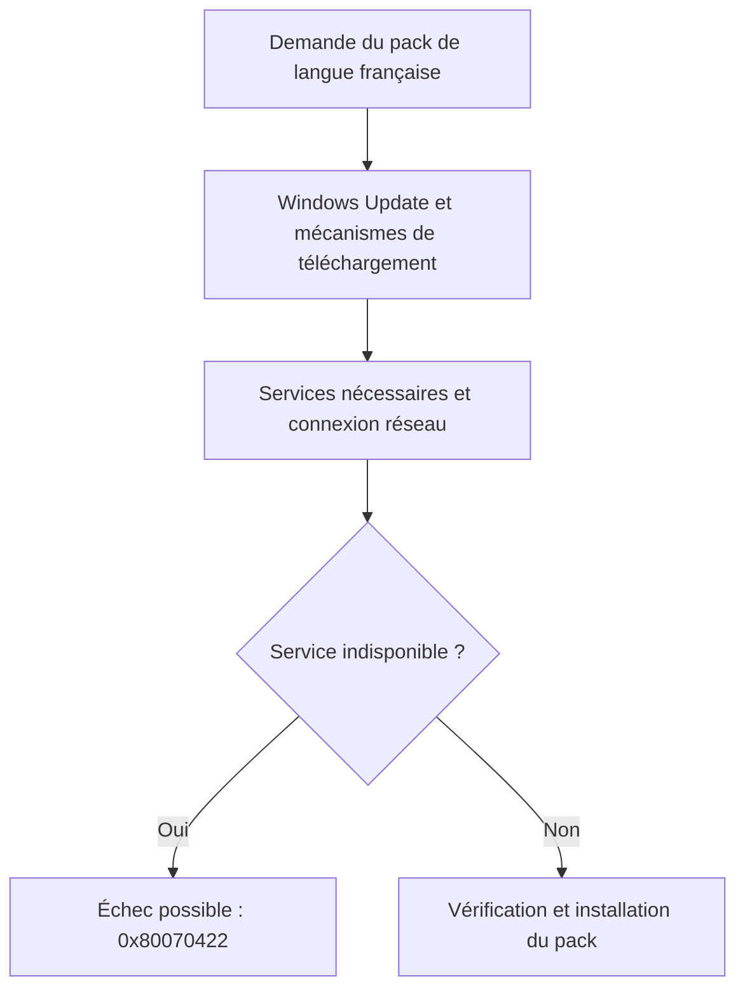

# Rapport de dépannage — Imprimante USB HP et Windows Update

## Sommaire

- [1. Résumé des incidents](#1-résumé-des-incidents)
- [2. Fonctionnement de l'impression](#2-fonctionnement-de-limpression)
- [3. Diagnostic rapide de l'imprimante](#3-diagnostic-rapide-de-limprimante)
- [4. Vider la file d'impression](#4-vider-la-file-dimpression)
- [5. Ports USB001 et USB002](#5-ports-usb001-et-usb002)
- [6. Erreur 0x00000709](#6-erreur-0x00000709)
- [7. La page de test ne sort pas](#7-la-page-de-test-ne-sort-pas)
- [8. Erreur Windows Update 0x80070422](#8-erreur-windows-update-0x80070422)
- [9. Fiche réflexe pour une prochaine intervention](#9-fiche-réflexe-pour-une-prochaine-intervention)
- [10. Modèle de ticket GitHub](#10-modèle-de-ticket-github)
- [11. Documentation officielle](#11-documentation-officielle)

## 1. Résumé des incidents

| Incident | Observation | Diagnostic / piste | État final connu |
| --- | --- | --- | --- |
| Impression impossible | 3 puis 4 documents en attente | File bloquée, port ou communication | Non résolu de façon confirmée |
| Périphérique « Unspecified » | Fabricant et catégorie non renseignés | Métadonnées ou reconnaissance incomplète ; pas une preuve de pilote absent | Pilote présent, USB détecté |
| Deux files HP M452 | USB001 en erreur, USB002 en état Normal | Ancienne file ou mauvaise association possible | Association relevée, impression non confirmée |
| `0x00000709` | Échec de la commande de test | Nom de l'imprimante mal saisi (espaces manquants) | Contourné par recherche automatique du nom |
| Page de test absente | `ReturnValue : 0`, puis file USB002 vide | Windows a accepté la demande ; sortie physique non garantie | Non résolu |
| Papier Letter | Word utilise Letter | Incompatibilité possible si le bac contient du A4 | Correction proposée |
| `0x80070422` | Installation de la langue française impossible | Service nécessaire possiblement désactivé | Non résolu de façon confirmée |
| Windows Update / BITS | Tous deux arrêtés | Vérifier le type de démarrage, puis démarrer si autorisé | Réactivation proposée, non confirmée |

> [!IMPORTANT]
> Le statut `Normal`, une file vide et un code de retour `0` ne prouvent pas qu'une feuille est sortie. Le test final doit être une impression physique réussie.

## 2. Fonctionnement de l'impression



Schéma simplifié : le pilote et le spouleur coopèrent pour préparer et transmettre les données. Le spouleur (`Spooler`) gère les travaux, le pilote prépare les données d'impression, le port virtuel indique la destination et le câble assure la liaison physique.

## 3. Diagnostic rapide de l'imprimante

Ouvrir **Windows PowerShell en tant qu'administrateur** pour les opérations de maintenance. Les commandes de consultation ne modifient rien.

### 3.1 Vérifier les files, les pilotes et les ports

```powershell
Get-Printer | Format-Table Name,DriverName,PortName,PrinterStatus -AutoSize
Get-PrinterDriver | Format-Table Name,Manufacturer -AutoSize
Get-PrinterPort | Format-Table Name,Description -AutoSize
Get-Service Spooler | Format-Table Name,Status,StartType
```

Résultat relevé pendant l'intervention (noms et états des files) :

| File Windows | Port | État |
| --- | --- | --- |
| HP Color LaserJet Pro M452 | USB002 | Normal |
| HP Color LaserJet Pro M452 PCL 6 | USB001 | Error |

Le spouleur était `Running` et le pilote HP PCL 6 était installé. Le port USB002 était identifié dans les informations affichées comme associé à la M452dn ; cela ne prouvait pas que la transmission fonctionnait.

### 3.2 Vérifier les périphériques USB présents

`Win + R`, puis :

```text
devmgmt.msc
```

Ou, dans PowerShell :

```powershell
Get-PnpDevice -PresentOnly |
    Where-Object { $_.InstanceId -like 'USBPRINT\*' } |
    Format-List FriendlyName,InstanceId,Status
```

Cette commande liste les périphériques d'impression USB correspondants ; elle ne donne pas à elle seule la correspondance avec USB001 ou USB002. Une liste vide ne suffit pas non plus à conclure à une panne matérielle.

Pour les propriétés de l'imprimante : `Win + R` → `control printers` → clic droit sur le périphérique → `Properties` → `Hardware`. Dans la conversation, la fonction sélectionnée indiquait `This device is working properly`.

| Code du Gestionnaire de périphériques | Signification générale |
| --- | --- |
| 28 | Pilotes non installés |
| 10 | Périphérique impossible à démarrer |
| 43 | Windows a arrêté le périphérique après un problème signalé |
| 31 | Windows ne peut pas charger les pilotes nécessaires |

Si un code apparaît, noter sa valeur exacte avant toute réinstallation.

## 4. Vider la file d'impression

### 4.1 Ouvrir la fenêtre des documents en attente

Appuyer sur `Win + R` et exécuter :

```cmd
rundll32 printui.dll,PrintUIEntry /o /n "HP Color LaserJet Pro M452"
```

Autre méthode : `control printers` → clic droit sur la file HP → `See what's printing` (Afficher les travaux d'impression).

Dans la fenêtre : menu `Printer` → `Cancel All Documents`. Vérifier également que `Pause Printing` et `Use Printer Offline` ne sont pas activés.

### 4.2 Voir les travaux des deux files HP

```powershell
Get-Printer -Name '*M452*' | ForEach-Object {
    Write-Host "File : $($_.Name)"
    Get-PrintJob -PrinterName $_.Name |
        Format-Table ID,DocumentName,JobStatus -AutoSize
}
```

Une file vide ne signifie pas que les autres files sont vides. Dans notre cas, il y avait deux files HP.

### 4.3 Annuler uniquement les travaux HP M452

Après accord de l'utilisateur, car il devra relancer les impressions annulées :

```powershell
Get-Printer -Name '*M452*' | ForEach-Object {
    Get-PrintJob -PrinterName $_.Name | Remove-PrintJob
}
```

### 4.4 Nettoyage forcé (dernier recours pour une file bloquée)

> [!WARNING]
> Cette opération annule les travaux de **toutes les imprimantes locales**. Elle ne supprime pas les fichiers Word ou PDF originaux. Sur un serveur ou un PC partagé, obtenir l'accord des personnes concernées. Si le spouleur ne s'arrête pas, ne pas supprimer les fichiers et traiter l'erreur en premier.

Dans PowerShell administrateur (configuration standard du dossier de spoule) :

```powershell
Stop-Service -Name Spooler -ErrorAction Stop
try {
    Get-ChildItem -LiteralPath "$env:SystemRoot\System32\spool\PRINTERS" -File -Force |
        Remove-Item -Force -ErrorAction Stop
}
finally {
    Start-Service -Name Spooler
}
```

Vérifier ensuite `Get-Service Spooler` et les files. Le dossier lui-même doit rester présent.

## 5. Ports USB001 et USB002

### 5.1 Port virtuel ou prise physique ?

`USB001` et `USB002` sont des noms de ports **virtuels d'impression** gérés par Windows, et non les numéros des prises USB physiques. Ils n'indiquent ni la vitesse ni la version USB (2.0, 3.0, etc.).



Cet exemple représente deux imprimantes physiques distinctes. Dans la conversation, il s'agissait de deux files Windows pour une HP M452, et non de deux imprimantes physiques confirmées.

### 5.2 Comment Windows choisit un port

1. Le mécanisme Plug and Play détecte le périphérique USB.
2. Windows lit ses identifiants (fabricant VID, produit PID, numéro de série si disponible).
3. Il distingue les instances des périphériques, selon leurs identifiants et leur emplacement notamment.
4. Le sous-système USB d'impression (`usbprint.sys`, `USBMON`) permet la communication.
5. Windows crée ou réutilise un port virtuel et la file peut être associée à ce port.

Les numéros ne suivent pas une règle fixe liée aux prises. En changeant de prise, un port peut être réutilisé ou un autre peut être créé. Deux imprimantes identiques peuvent également avoir des ports distincts.

### 5.3 Situation observée



### 5.4 Modifier une association uniquement après vérification

Ne pas supposer que `USB002` sera le bon port sur un autre PC. Relever les associations avant et après avoir branché une seule imprimante à la fois (si possible et sans interrompre des travaux). Vérifier aussi la description des ports et tester chaque file.

Pour changer un port, sauvegarder d'abord l'ancien :

```powershell
$name = 'HP Color LaserJet Pro M452'
$oldPort = (Get-Printer -Name $name).PortName
$oldPort
```

Si USB002 est confirmé comme destination de cette file et qu'elle n'y est pas déjà associée :

```powershell
Set-Printer -Name $name -PortName 'USB002'
Get-Printer -Name $name | Format-List Name,PortName,PrinterStatus
```

Pour revenir à l'ancien port, dans la même session PowerShell :

```powershell
Set-Printer -Name $name -PortName $oldPort
```

Ne pas supprimer les anciennes files ou pilotes tant que la bonne file n'a pas imprimé une feuille. Après validation, sélectionner la file fonctionnelle par défaut si souhaité ; conserver ou supprimer les doublons uniquement avec autorisation.

## 6. Erreur 0x00000709

**Symptôme :** `Operation could not be completed (error 0x00000709)` lors de la commande d'impression de test.

**Piste dans notre cas :** nom mal saisi (espaces manquants). Ce code peut avoir d'autres causes dans d'autres situations ; il ne justifie pas de modifier le registre sans diagnostic.

```text
Incorrect : HP ColorLaserJetPro M452
Correct   : HP Color LaserJet Pro M452
```

Afficher le nom réel :

```powershell
Get-Printer -Name '*M452*' | Format-List Name,PortName,PrinterStatus
```

Lancer une page de test (avec le nom exact) :

```cmd
rundll32 printui.dll,PrintUIEntry /k /n "HP Color LaserJet Pro M452"
```

Ou rechercher le nom automatiquement, comme pendant l'intervention :

```powershell
Get-CimInstance Win32_Printer |
    Where-Object { $_.Name -like '*M452' } |
    Invoke-CimMethod -MethodName PrintTestPage
```

Le filtre ci-dessus sélectionne les noms se terminant par `M452` et exclut donc la file se terminant par `PCL 6` dans ce cas. Sur un autre PC, vérifier les noms avant d'envoyer le test.

**Résultat observé :** `ReturnValue : 0`. La commande a réussi côté Windows, mais aucune feuille n'est sortie.

## 7. La page de test ne sort pas

### 7.1 Tester sans ordinateur

Sur le panneau LCD de la HP M452dn, appuyer sur `OK`, utiliser les flèches pour sélectionner `Reports` (Rapports), puis `Configuration Report` (Rapport de configuration). Vérifier le papier et l'écran de l'imprimante.



Un rapport interne réussi oriente vers la liaison ou la configuration informatique ; il ne prouve pas que l'interface USB de l'imprimante fonctionne.

### 7.2 Contrôles USB et papier

- Vérifier l'écran de l'imprimante : `Ready`, manque de papier, bourrage ou demande de format.
- Débrancher puis rebrancher le câble ; essayer une autre prise USB directement sur le PC, sans hub.
- Si besoin, éteindre et rallumer l'imprimante lorsqu'elle est inactive, puis vérifier à nouveau les ports Windows.
- Essayer un autre câble USB de données connu comme fonctionnel.
- Dans Word, choisir `A4` si le papier du bac est A4, puis vérifier la configuration du bac.

| Format | Dimensions |
| --- | --- |
| A4 | 210 × 297 mm |
| Letter | 215,9 × 279,4 mm |

### 7.3 Si le pilote doit être réinstallé

Seulement après les vérifications précédentes : noter la configuration, télécharger le pilote HP compatible avec le modèle exact et la version de Windows depuis le support officiel, puis suivre les instructions d'installation. Débrancher le câble si l'installateur le demande. Tester une feuille avant de retirer une ancienne file. Ne pas supprimer un pilote partagé par d'autres imprimantes.

**Limite de l'intervention :** le résultat du rapport interne HP, du test d'un autre câble et d'une éventuelle réinstallation n'a pas été communiqué.

## 8. Erreur Windows Update 0x80070422

### 8.1 Symptôme et diagnostic

Le téléchargement de la langue française et de ses composants échouait. Le code `0x80070422` correspond à un service qui ne peut pas démarrer parce qu'il est désactivé ou n'a pas de périphérique activé associé. Dans ce contexte, Windows Update est une piste principale.

```powershell
Get-Service wuauserv,BITS,cryptsvc,TrustedInstaller |
    Format-Table Name,Status,StartType -AutoSize
```

| Service | Rôle simplifié | État observé |
| --- | --- | --- |
| wuauserv | Recherche et gestion des mises à jour | Stopped |
| BITS | Transferts de fichiers en arrière-plan | Stopped |
| cryptsvc | Vérification des signatures | Running |
| TrustedInstaller | Maintenance des composants Windows | Running |

`Stopped` veut dire arrêté, tandis que `Disabled` veut dire désactivé. Un service en démarrage manuel peut normalement être arrêté quand il est inutilisé. Le type de démarrage n'avait pas encore été confirmé dans les captures.



Schéma simplifié : ces services coopèrent, mais ils ne constituent pas une chaîne fixe et BITS n'est pas le seul mécanisme de téléchargement.

### 8.2 Réactiver les services si nécessaire

> [!CAUTION]
> Sur un PC professionnel, vérifier auprès de l'administrateur si Windows Update ou BITS est désactivé par une stratégie de l'organisation. Ne pas contourner cette stratégie. Noter les types de démarrage initiaux avant toute modification.

Dans PowerShell administrateur, si les services sont désactivés et que la modification est autorisée :

```powershell
Set-Service -Name wuauserv -StartupType Manual
Set-Service -Name BITS -StartupType Manual
```

Démarrer les services nécessaires :

```powershell
Start-Service -Name wuauserv
Start-Service -Name BITS
Get-Service wuauserv,BITS | Format-Table Name,Status,StartType
```

Ils devraient pouvoir démarrer. Ils peuvent s'arrêter automatiquement plus tard quand ils ne sont plus utilisés. Si une commande échoue, noter le message exact ; ne pas répéter les commandes à l'aveugle.

### 8.3 Réessayer l'installation du français

Windows 10 : `Settings` → `Time & Language` → `Language` → `French (France)` → `Options` → `Download` (Language pack). Une fois installé, choisir le français comme langue d'affichage, puis fermer et rouvrir la session si demandé.

Si cela échoue encore : vérifier le réseau, les restrictions de l'organisation et l'édition de Windows (une édition Single Language peut limiter le changement de langue). Utiliser l'utilitaire de résolution Windows Update avant une réparation plus lourde.

### 8.4 Réparer Windows si nécessaire

Dans CMD ou PowerShell administrateur, si une corruption des composants est suspectée :

```cmd
DISM /Online /Cleanup-Image /RestoreHealth
sfc /scannow
```

DISM répare le magasin de composants ; SFC vérifie les fichiers système. Attendre la fin de chaque commande, noter les résultats. DISM peut nécessiter Windows Update ou une source de réparation compatible. Redémarrer si nécessaire.

**Lien avec l'imprimante :** Windows Update indisponible peut gêner la recherche automatique de certains pilotes. Cela ne prouve pas qu'il soit la cause de la panne d'impression observée.

## 9. Fiche réflexe pour une prochaine intervention

### Commandes de consultation

| Commande | Utilité |
| --- | --- |
| `control printers` | Ouvrir les périphériques et imprimantes |
| `devmgmt.msc` | Ouvrir le Gestionnaire de périphériques |
| `services.msc` | Afficher les services Windows |
| `Get-Printer` | Lister les files d'impression |
| `Get-PrinterDriver` | Lister les pilotes |
| `Get-PrinterPort` | Lister les ports |
| `Get-PrintJob -PrinterName "Nom exact"` | Lister les travaux d'une file |
| `Get-Service Spooler` | Vérifier le service d'impression |
| `Get-Service wuauserv,BITS` | Vérifier les services de mise à jour |
| `winver` | Afficher la version de Windows |

### Checklist de validation

- [x] Imprimante détectée par Windows pendant l'intervention.
- [x] Pilote HP PCL 6 présent.
- [x] Spouleur en cours d'exécution lors du contrôle.
- [x] Deux files et leurs ports identifiés.
- [x] Demande de page de test acceptée par Windows.
- [ ] Toutes les files concernées vidées (nettoyage complet non confirmé).
- [ ] Rapport interne HP imprimé.
- [ ] Page de test Windows réellement sortie.
- [ ] Document Word imprimé au format adapté.
- [ ] Windows Update et BITS démarrent sans erreur.
- [ ] Pack français téléchargé et langue d'affichage vérifiée.

Les cases cochées correspondent aux constats de la conversation, pas à l'état actuel du PC.

## 10. Modèle de ticket GitHub

Copier ce modèle dans une nouvelle issue ou un rapport lors d'une prochaine intervention.

```markdown
## Incident
- Date :
- Version de Windows :
- Modèle imprimante :
- Connexion : USB / réseau
- Message ou code exact :

## Diagnostic avant modification
- Rapport interne imprimé : oui / non / non testé
- Pilote :
- Nom de la file :
- Port :
- État du spouleur :
- Travaux en attente :
- État et type de démarrage Windows Update / BITS :

## Actions effectuées
1.
2.

## Résultat réel
- Page de test physique : oui / non
- Impression Word : oui / non
- Téléchargement du pack de langue : oui / non / non concerné
- Statut : résolu / en cours / à escalader

## Cause confirmée ou hypothèses restantes

## Captures et journaux anonymisés
```

Avant de publier sur GitHub, retirer les noms d'utilisateurs, noms de documents confidentiels, adresses IP internes et numéros de série si non nécessaires. Ne jamais publier de mots de passe ou de clés.

## 11. Documentation officielle

Les liens ci-dessous complètent les observations de la conversation ; ils servent de référence pour les commandes et le fonctionnement technique.

- [Microsoft — Commandes PrintUIEntry (file et page de test)](https://learn.microsoft.com/fr-fr/windows-server/administration/windows-commands/rundll32-printui)
- [Microsoft — Get-PrintJob](https://learn.microsoft.com/powershell/module/printmanagement/get-printjob)
- [Microsoft — Remove-PrintJob](https://learn.microsoft.com/en-us/powershell/module/printmanagement/remove-printjob)
- [Microsoft — Pilote USB Microsoft (usbprint.sys)](https://learn.microsoft.com/fr-fr/windows-hardware/drivers/print/usb-printing)
- [Microsoft — Imprimante connectée à un port USB](https://learn.microsoft.com/fr-fr/windows-hardware/drivers/print/printer-connected-to-a-usb-port)
- [HP — Configuration matérielle M452 et impression du rapport](https://support.hp.com/gb-en/document/c04824496)
- [HP — Dépannage M452dn](https://support.hp.com/gb-en/product/troubleshooting/hp-color-laserjet-pro-m452-series/model/7326535)

---

**Conclusion :** ne pas confondre la détection d'une imprimante avec une impression réussie, ni un service arrêté avec un service désactivé. Toujours identifier la cause avec un test simple avant de modifier ou réinstaller une configuration.
